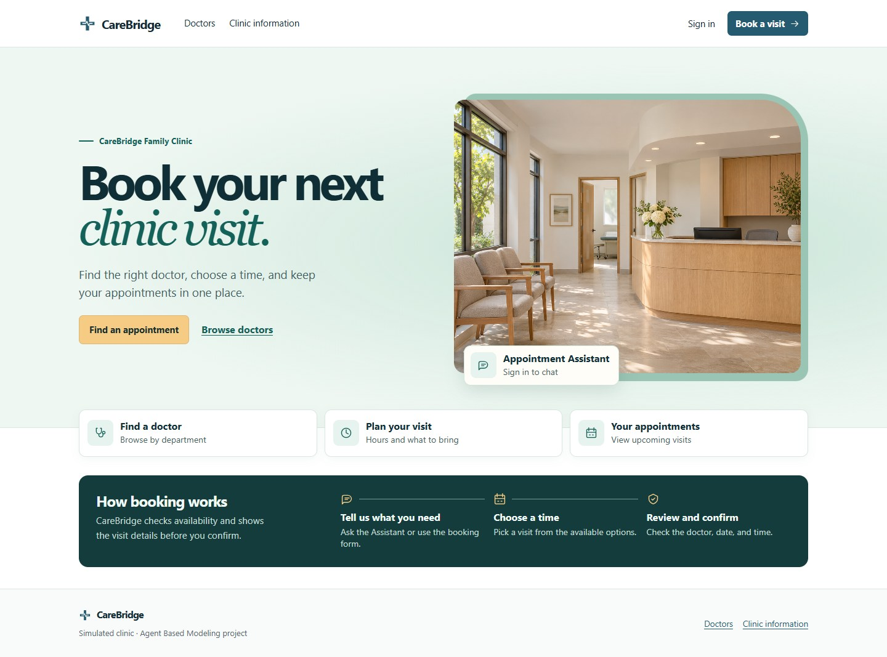
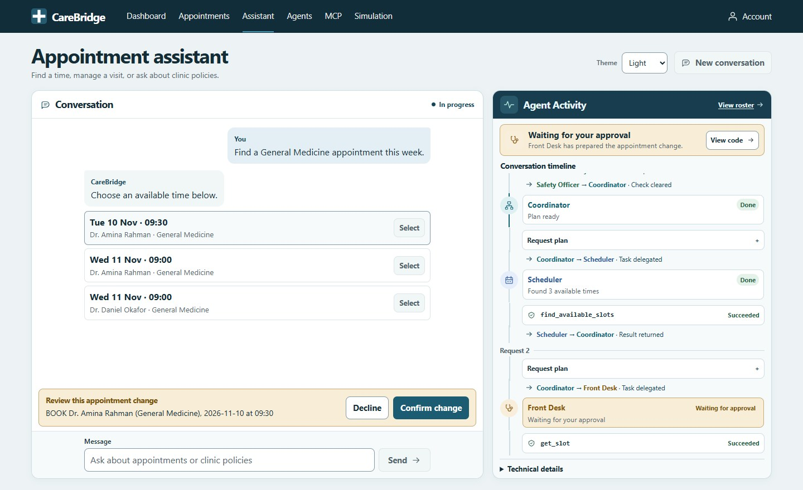
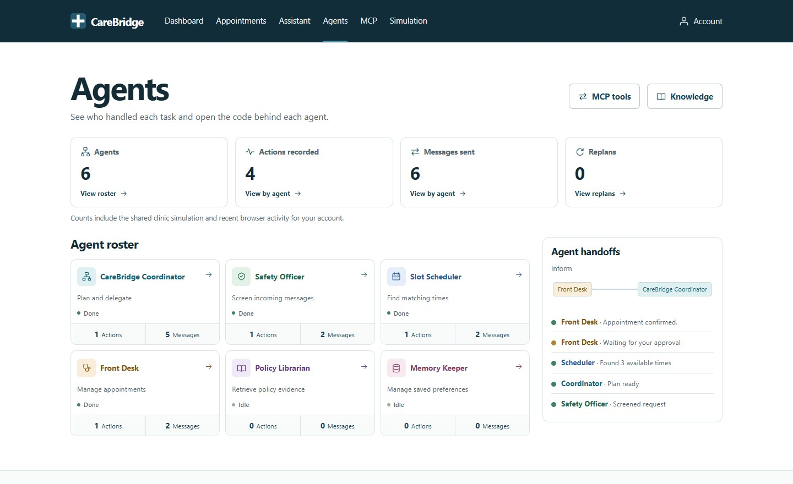
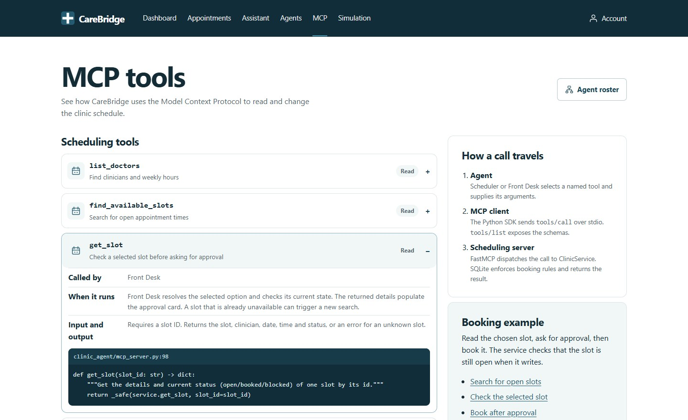
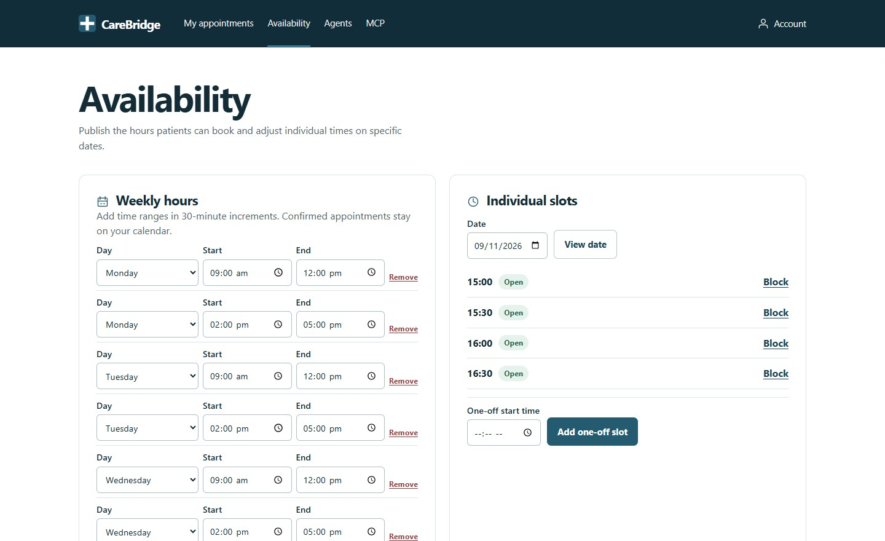
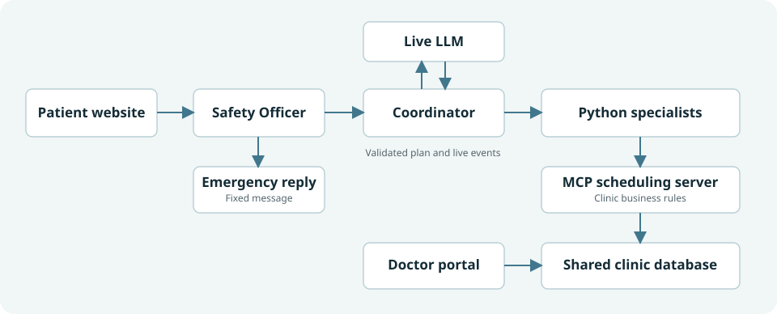

# CareBridge

[](#quick-start)
[](clinic_agent/web.py)
[](clinic_agent/mcp_server.py)
[](clinic_agent/rag.py)
[](#testing)

**AIDE3313 · Agent Based Modeling · Healthcare Appointment Assistant**

CareBridge is a simulated clinic with patient and doctor portals. A live LLM turns a patient’s request into a structured plan. Python agents search for appointments, check policies, manage preferences, and replan when availability changes. The interface shows who did the work and lets you inspect the agent’s Python code.

[Screenshots](#screenshots) · [Quick start](#quick-start) · [Demo walkthrough](#demo-walkthrough) · [Architecture](#architecture) · [Testing](#testing) · [Viva guide](docs/viva.md)

## What you can do

- **Patients** can sign up with an email and password, browse doctors, and book, reschedule, or cancel visits. Every appointment change requires explicit approval.
- **Doctors** can publish weekly hours, add or block individual slots, and see upcoming visits. Schedule edits preserve confirmed bookings.
- **Presenters** can follow live handoffs and approval waits in the Assistant, open agent KPIs and source excerpts, and simulate slot conflicts or doctor leave.
- **Policy and memory** support includes cited answers from the clinic knowledge base and saved scheduling preferences that carry across conversations.

## Screenshots

### Clinic homepage



### Assistant and agent timeline



<details>
<summary>Agents dashboard</summary>



</details>

<details>
<summary>MCP tool reference</summary>



</details>

<details>
<summary>Doctor availability</summary>



</details>

## Quick start

On Windows, use [`start-project.bat`](start-project.bat) with the [plain-text run guide](HOW_TO_RUN.txt).

Use **Python 3.11** and credentials for an Anthropic or OpenAI-compatible model. Node.js is needed only for the JavaScript checks.

From the repository root, create and activate a virtual environment.

**Windows PowerShell**

```powershell
py -3.11 -m venv .venv
./.venv/Scripts/Activate.ps1
if (-not (Test-Path .env)) { Copy-Item .env.example .env }
```

**macOS or Linux**

```bash
python3.11 -m venv .venv
source .venv/bin/activate
[ -f .env ] || cp .env.example .env
```

Install the dependencies, then set the provider and credentials in your local `.env`. The [configuration template](.env.example) has examples for both provider types.

```bash
python -m pip install -r requirements.txt
```

| Provider | Settings |
| --- | --- |
| Anthropic | `LLM_PROVIDER=anthropic` and `ANTHROPIC_API_KEY`. Set `LLM_MODEL` to select a different model. |
| OpenAI-compatible | `LLM_PROVIDER=openai`, `OPENAI_API_KEY`, and `LLM_MODEL`. Set `OPENAI_BASE_URL` when using another provider’s compatible endpoint. |

Check that the model returns a valid plan, then start the website.

```bash
python scripts/check_llm.py
python -m clinic_agent.web --demo-doctor-signup
```

Open [CareBridge on port 8000](http://127.0.0.1:8000). The startup process seeds the synthetic clinic on first use. The neural embedding model downloads on the first policy search. To prepare the knowledge index before the demo, run `python scripts/setup_data.py --kb-only`.

Patient and demo doctor accounts activate immediately after sign-up. SMTP is optional and is used for password recovery. During a loopback demo without SMTP, reset links are written to `data/mailbox/`. Keep provider credentials in the local `.env`.

## Demo walkthrough

1. **Publish a slot.** Create a demo doctor account in General Medicine. Open **Availability** and add a weekly time range or a one-off slot.
2. **Book as a patient.** In a separate browser profile, create a patient account and use **Doctors** or **Assistant** to find the slot. Approve the booking and check that it appears in the doctor’s agenda.
3. **Inspect the agents.** Watch the Assistant’s activity timeline. Open **Agents**, select a KPI or agent card, and inspect the result, role, source excerpt, and file path.
4. **Trigger a replan.** Arm a slot conflict from **Simulation** and try a booking. Follow the Front Desk refusal and the Scheduler’s search for alternatives.

The [viva guide](docs/viva.md) also covers doctor leave, changing hours after a booking, and how to find the relevant implementation during the presentation. For a terminal walkthrough with separate demo databases, run `python scripts/run_demo.py --interactive`.

## Architecture



The Safety Officer screens incoming messages before planning. The Coordinator validates the LLM’s task plan and delegates each task to its owner. The Scheduler and Front Desk use a separate MCP server over stdio. The Policy Librarian retrieves passages from ChromaDB, and the Memory Keeper uses SQLite to store non-clinical preferences. The doctor portal and scheduling services share the same clinic database.

Synthetic Patient Agents can compete for the same slot during a simulation tick. The resulting conflict is recorded, and the workflow can request a new option. The Assistant streams plans, handoffs, outcomes, and replans over WebSockets.

### Repository map

| Location | Responsibility |
| --- | --- |
| [`clinic_agent/agents/`](clinic_agent/agents/) | Coordinator, task plan validation, and specialist agents |
| [`clinic_agent/simulation/`](clinic_agent/simulation/) | Clinic environment, message bus, and simulation ticks |
| [`clinic_agent/doctor_schedule.py`](clinic_agent/doctor_schedule.py) and [`clinic_agent/clinic_tools.py`](clinic_agent/clinic_tools.py) | Doctor availability, slots, and appointment rules |
| [`clinic_agent/mcp_server.py`](clinic_agent/mcp_server.py) and [`clinic_agent/mcp_client.py`](clinic_agent/mcp_client.py) | Scheduling tools and stdio transport |
| [`clinic_agent/web.py`](clinic_agent/web.py) and [`web/`](web/) | Starlette routes, patient and doctor portals, and agent activity views |
| [`data/kb/`](data/kb/) | Markdown documents for the simulated clinic’s policy knowledge base |
| [`scripts/`](scripts/) and [`tests/`](tests/) | Setup, demos, and automated checks |

Read the [architecture notes](docs/architecture.md), [prompt rationale](docs/prompt_justification.md), and [requirements traceability matrix](docs/requirements_traceability.md) for more detail.

## Testing

```bash
python -m unittest discover -s tests -v
node tests/ui_logic_test.js
```

The Python suite uses isolated data and exercises a real MCP subprocess. Neural retrieval tests run with a cached model. Set `RUN_NEURAL_TESTS=1` to enable the download during testing. The live-provider smoke check is `python scripts/check_llm.py`.

## Project team

- [@sheralisaleem](https://github.com/sheralisaleem/)
- [@SyedRazaZaidi](https://github.com/SyedRazaZaidi)
- [@kheshamsyed05](https://github.com/kheshamsyed05)
