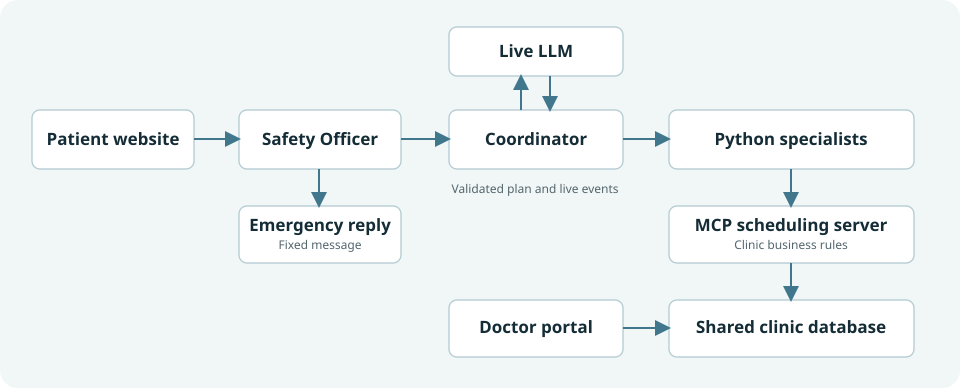
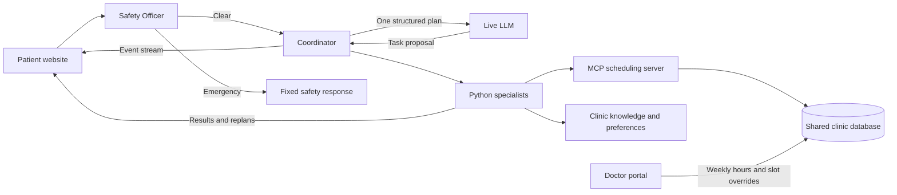

# Architecture

## Patient requests

The Coordinator gives the live model recent conversation, presented slot references, the clinic clock, and saved scheduling preferences. The model submits one `TurnPlan`. Python validates the entire plan before it dispatches tasks. A portal action such as selecting a slot supplies a typed task and follows the same execution path.

Scheduler reads MCP availability. Front Desk loads exact details for approval and supplies the signed-in patient ID to MCP. Policy Librarian returns cited passages above the evidence cutoff. Memory Keeper stores preferences and summarizes verified actions. Scheduler finds replacements after a conflict or clinic cancellation using Python.

## Doctor scheduling and simulation

Doctors publish weekly time ranges and dated overrides. Edits reconcile unbooked slots under SQLite transactions. Confirmed bookings keep their slot until a separate appointment action changes them. The Doctor Agent emits a message when a schedule edit succeeds.

Two synthetic Patient Agents can request the same slot in one tick before Front Desk processes their booking attempts. The conflict sends a patient into a later tick to find a different slot. Simulation uses the same clinic slots and rules as patient bookings.

## Identity and traces

Pages and WebSockets use revocable server-side sessions. Each patient session has its own agent state, conversation, and trace stream. Shared occupancy and simulation events are visible in the app. Appointments and preferences are scoped to the authenticated account.
